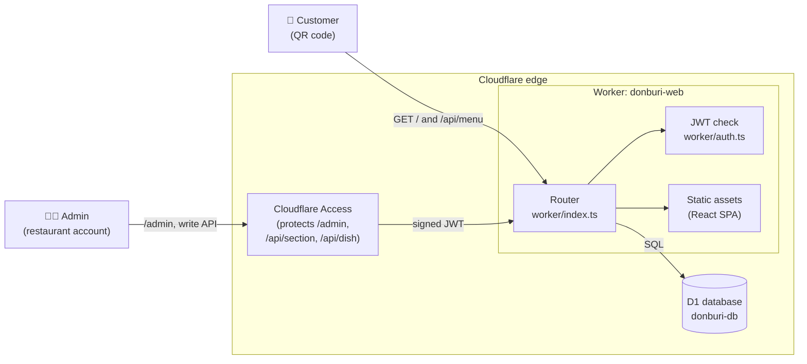
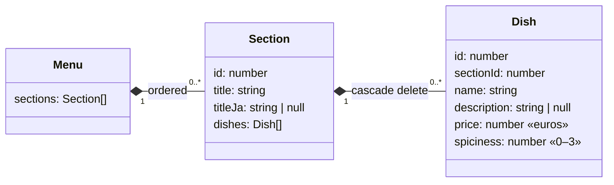
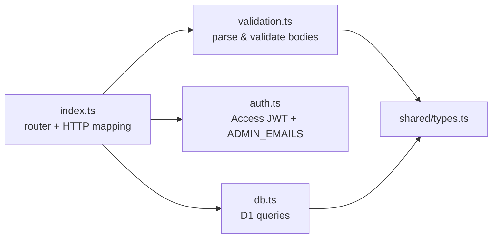
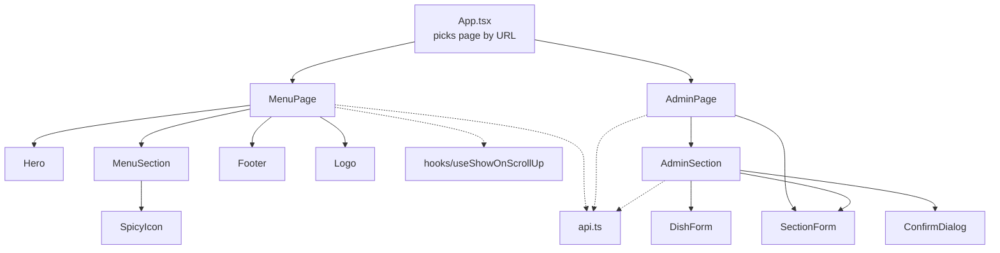

# Donburi Ramen Bar — Digital Menu 🍜

A mobile-first digital menu for **Donburi Ramen Bar**, a ramen restaurant in Gijón (Spain). Customers scan a QR code on the table and get the menu on their phone; the owner edits sections and dishes from a password-protected admin panel, and changes appear instantly.

The whole app — website, API and database — runs serverless on the **Cloudflare Developer Platform**.

- **Live menu:** https://donburi-web.donburi-ramen.workers.dev
- **Specification:** [`requirements.md`](requirements.md) (in Spanish) is the source of truth for features and the test plan. Requirement IDs such as `CL1.2.4` or `PIA5` used below and in test names refer to it.
- **Language:** the user interface and API messages are in Spanish; code and this README are in English.

---

## Contents

1. [Features](#features)
2. [Technology stack](#technology-stack)
3. [Architecture](#architecture)
4. [Code design](#code-design)
5. [Serverless infrastructure](#serverless-infrastructure)
6. [Test suite](#test-suite)
7. [Local development](#local-development)
8. [Deploying to Cloudflare](#deploying-to-cloudflare)
9. [Project structure](#project-structure)
10. [Status and roadmap](#status-and-roadmap)

---

## Features

### Public menu (`/`)
- Opening screen with the restaurant logo and an illustration; a bouncing **"Carta"** arrow invites the customer to scroll down (tapping it scrolls smoothly to the menu).
- Sections (starters, ramen, stir-fries, desserts, drinks…) with a centred title and its **Japanese title** underneath (e.g. *Ramen* / ラーメン).
- Each section can be collapsed (−) and expanded (+) with a smooth animation.
- Each dish shows name, optional description and price, joined by a thin line; spicy dishes show **one to three chilli peppers** 🌶️.
- Empty sections — and an empty menu — show *"Work In Progress..."*.
- The logo hides while scrolling down and comes back, smaller and without its lettering, when scrolling up.
- Footer with address, phone number, and WhatsApp and Instagram icons.
- Warm, light design: parchment *seigaiha* (wave) background, espresso-coloured text, **Shippori Mincho** typeface, terracotta frame and footer.

### Admin panel (`/admin/`)
- Protected by **Cloudflare Access**: only the restaurant's own account can sign in.
- Create, rename and delete sections (with an optional Japanese title); deleting asks for confirmation and removes the section's dishes.
- Create, edit and delete dishes: name, optional description, price and spiciness level (0–3).
- Reorder sections by **drag and drop** (mouse, touch or keyboard).
- Section titles are unique across the menu and dish names unique within a section (case-insensitive); duplicates are rejected with a clear error and nothing changes.

---

## Technology stack

| Layer | Technology |
|---|---|
| Frontend | [React 19](https://react.dev/) + TypeScript, built with [Vite](https://vite.dev/) |
| Drag & drop | [dnd-kit](https://dndkit.com/) (`@dnd-kit/core`, `sortable`, `modifiers`) |
| Typography | [Shippori Mincho](https://fonts.google.com/specimen/Shippori+Mincho), self-hosted via `@fontsource` |
| Backend / API | [Cloudflare Workers](https://developers.cloudflare.com/workers/) (TypeScript, no framework) |
| Static hosting | [Workers Static Assets](https://developers.cloudflare.com/workers/static-assets/) |
| Database | [Cloudflare D1](https://developers.cloudflare.com/d1/) (serverless SQLite) |
| Authentication | [Cloudflare Access](https://developers.cloudflare.com/cloudflare-one/policies/access/) (Zero Trust) + JWT verification with [`jose`](https://github.com/panva/jose) |
| Tooling | [Wrangler](https://developers.cloudflare.com/workers/wrangler/), [`@cloudflare/vite-plugin`](https://developers.cloudflare.com/workers/vite-plugin/), [oxlint](https://oxc.rs/) |
| Tests | [Vitest](https://vitest.dev/), [`@cloudflare/vitest-plugin`](https://developers.cloudflare.com/workers/testing/vitest-integration/), [Testing Library](https://testing-library.com/), [Selenium WebDriver](https://www.selenium.dev/) + headless Chromium |

---

## Architecture

The app is a **single Cloudflare Worker** that serves both the React single-page app (as static assets) and a small JSON API backed by a D1 database. There is no separate frontend host and no server to manage.



**How a request flows:**

1. **Public pages and assets** (`/`, scripts, styles, images, fonts) are served directly from Workers Static Assets. Unknown paths fall back to `index.html` (single-page-app routing).
2. **`/api/*` and `/admin*`** always run through the Worker first (`run_worker_first` in `wrangler.jsonc`).
3. **`GET /api/menu`** is public: the Worker reads all sections and dishes from D1 and returns them as JSON (`Cache-Control: no-store`, so edits show instantly).
4. **Admin routes** are protected twice:
   - **Cloudflare Access** sits in front of `/admin`, `/api/section` and `/api/dish`. Unauthenticated visitors are redirected to the Cloudflare login, where the owner receives a one-time code by email.
   - **The Worker itself** then verifies the Access JWT (signature, issuer and audience) and checks that the token's email is in the `ADMIN_EMAILS` secret. This second barrier keeps the panel closed even if the Access policy were loosened by mistake, and also covers preview URLs that bypass the Access application.
   - If any of the authentication settings is missing, admin routes **fail closed** (HTTP 500) rather than open.

### REST API

| Method | Path | Auth | Description |
|---|---|---|---|
| `GET` | `/api/menu` | public | Full menu: sections in order, each with its dishes |
| `POST` | `/api/section` | admin | Create a section `{ title, titleJa? }` |
| `PUT` | `/api/section/:id` | admin | Rename a section `{ title, titleJa? }` |
| `DELETE` | `/api/section/:id` | admin | Delete a section and all its dishes |
| `PUT` | `/api/section/order` | admin | Reorder sections `{ sectionIds: [...] }` (must list every section) |
| `POST` | `/api/dish` | admin | Create a dish `{ sectionId, name, description?, price, spiciness? }` |
| `PUT` | `/api/dish/:id` | admin | Update a dish `{ name, description?, price, spiciness? }` |
| `DELETE` | `/api/dish/:id` | admin | Delete a dish |

Errors are returned as `{ "error": <code>, "message": <Spanish text> }`, and the admin panel shows the message as-is:

| Status | Code | When |
|---|---|---|
| 400 | `VALIDATION_ERROR` | Invalid body (missing name, negative price, spiciness outside 0–3…) |
| 401 | `UNAUTHORIZED` | Missing or invalid Access token |
| 403 | `FORBIDDEN` | Valid token, but the email is not an administrator |
| 404 | `NOT_FOUND` | Unknown section, dish or route |
| 409 | `SECTION_EXISTS` / `DISH_EXISTS` | Duplicate section title / dish name in the section |
| 409 | `ORDER_CONFLICT` | Reorder list doesn't match the current sections (stale page) |
| 500 | `AUTH_NOT_CONFIGURED` | Access settings or `ADMIN_EMAILS` missing (fail closed) |

---

## Code design

The code is written in a functional style: plain TypeScript **types and modules** on the backend and **function components and hooks** on the frontend, with no class hierarchy. The domain model and the module structure are shown below.

### Domain model

The API types live in [`shared/types.ts`](shared/types.ts) and are imported by both the Worker and the React app, so both sides always agree on the data shape.



### Database schema (D1)

Created by the SQL files in [`migrations/`](migrations), applied in order:

| Table | Column | Notes |
|---|---|---|
| `sections` | `id` | `INTEGER PRIMARY KEY` |
| | `title` | `TEXT UNIQUE COLLATE NOCASE` |
| | `title_ja` | `TEXT`, optional (migration 0004) |
| | `"order"` | `INT`, position on the menu (migration 0002; `order` is a reserved word, so it is always quoted) |
| `dishes` | `id` | `INTEGER PRIMARY KEY` |
| | `section_id` | `REFERENCES sections(id) ON DELETE CASCADE` |
| | `name` | `TEXT COLLATE NOCASE`, `UNIQUE (section_id, name)` |
| | `description` | `TEXT`, optional |
| | `price_cents` | `INTEGER ≥ 0` (the API exposes euros) |
| | `spiciness` | `INTEGER 0–3` (migration 0003, replaced the old `is_spicy` flag) |

Uniqueness is enforced by the database itself, so two simultaneous requests can never create duplicates; the Worker maps the constraint error to a `409`.

### Backend modules (`worker/`)



| Module | Responsibility |
|---|---|
| [`index.ts`](worker/index.ts) | Entry point (`fetch` handler). Routes `/api/*` and `/admin*`, calls auth for protected routes, maps results to HTTP status codes and Spanish error messages, and hands everything else to the static assets. |
| [`auth.ts`](worker/auth.ts) | Reads the Access token (`Cf-Access-Jwt-Assertion` header or `CF_Authorization` cookie), verifies it against the team's public keys with `jose`, and checks the email against `ADMIN_EMAILS`. Returns `ok` or a reason (`missing_token`, `invalid_token`, `forbidden_email`, `not_configured`). |
| [`validation.ts`](worker/validation.ts) | Turns untrusted JSON into typed inputs (`SectionInput`, `DishInput`, `SectionOrderInput`), or returns a validation message. |
| [`db.ts`](worker/db.ts) | All SQL. Maps rows to domain types (cents ↔ euros, `title_ja` ↔ `titleJa`), runs multi-statement changes (delete a section with its dishes, reorder) as atomic batches, and reports `not_found` / `conflict`. |

### Frontend modules (`src/`)



| Area | Files | Notes |
|---|---|---|
| Routing | [`App.tsx`](src/App.tsx), [`routes.ts`](src/routes.ts) | No router library: `/admin…` renders the admin panel, anything else the menu. |
| Public menu | [`pages/MenuPage.tsx`](src/pages/MenuPage.tsx), [`components/`](src/components) | `Hero` (opening screen), `MenuSection` (collapsible section), `SpicyIcon`, `Footer`, `Logo` (full or compact variant). |
| Admin panel | [`pages/AdminPage.tsx`](src/pages/AdminPage.tsx), [`components/admin/`](src/components/admin) | `AdminSection` (one draggable section with its dishes), `SectionForm`, `DishForm`, `ConfirmDialog`. Reloads the menu after every change; reordering is optimistic and rolls back on error. |
| Data access | [`api.ts`](src/api.ts) | Typed `fetch` wrapper for every endpoint; turns error responses into `ApiRequestError` with the server's message. |
| Behaviour | [`hooks/useShowOnScrollUp.ts`](src/hooks/useShowOnScrollUp.ts) | Reports scroll direction and whether the page is at the top, to hide, show or shrink the logo header. |
| Configuration | [`config.ts`](src/config.ts), [`format.ts`](src/format.ts) | Restaurant address, phone and Instagram; price (`es-ES`, EUR) and spiciness label formatting. |
| Styling | [`index.css`](src/index.css), [`App.css`](src/App.css), [`assets/`](src/assets) | Design tokens (colours, font), layout, phone breakpoint (`max-width: 599px`) and the SVG artwork. |

---

## Serverless infrastructure

Everything runs on Cloudflare's network; there are no servers, containers or VMs to maintain. All of it fits within Cloudflare's free tiers for a restaurant menu.

| Resource | Name | Purpose | Defined in |
|---|---|---|---|
| Worker | `donburi-web` | Runs the API and serves the SPA | `wrangler.jsonc` (`main: worker/index.ts`) |
| Static assets | binding `ASSETS` | The Vite build (HTML, JS, CSS, fonts, SVGs) | `wrangler.jsonc` `assets` |
| D1 database | `donburi-db`, binding `DB` | Sections and dishes | `wrangler.jsonc` `d1_databases`, schema in `migrations/` |
| Variables | `ACCESS_TEAM_DOMAIN`, `ACCESS_AUD` | Identify the Access team and application (not secret) | `wrangler.jsonc` `vars` |
| Secret | `ADMIN_EMAILS` | Comma-separated list of administrator emails | `wrangler secret put` (never in the repo) |
| Access application | self-hosted, on the Worker's hostname | Login in front of `admin`, `api/section`, `api/dish` | Cloudflare Zero Trust dashboard |
| Access policy | Allow → Emails | Only the restaurant's account may sign in | Cloudflare Zero Trust dashboard |

**Design choices:**
- **One Worker, one origin.** The SPA and the API share the same origin, so there is no CORS to configure, and the Access session cookie automatically covers the API calls made by the admin panel.
- **The Worker runs first only where it must.** Static files are served straight from the edge cache; only `/api/*` and `/admin*` execute Worker code.
- **D1 as the single source of truth**, with no images stored: only text and numbers, as required by the specification.
- **Defence in depth.** Cloudflare Access is the gatekeeper; the Worker re-verifies the token and the email and fails closed. The local-only `DEV_AUTH_BYPASS` flag lives in `.dev.vars`, which is never deployed or committed.
- **Configuration as code.** `wrangler.jsonc` is the source of truth for bindings: every deploy replaces the Worker's bindings with what the file says, so change bindings there rather than in the dashboard.

---

## Test suite

All tests run with **Vitest**, split into three projects (see [`vitest.config.ts`](vitest.config.ts)). Test names reference the requirement IDs in `requirements.md`.

| Suite | Count | Runs in | What it covers |
|---|---|---|---|
| **worker** — [`test/worker/`](test/worker) | 72 | The real Workers runtime (workerd) via `@cloudflare/vitest-plugin`, with a local D1 | Every API endpoint: validation, uniqueness, cascade delete, reordering, Japanese titles, spiciness, error codes. Authentication: JWT signature/issuer/audience/expiry with locally generated keys, the `ADMIN_EMAILS` second barrier, and fail-closed behaviour. |
| **client** — [`test/client/`](test/client) | 29 | jsdom with React Testing Library; `fetch` is stubbed | Menu rendering (empty states, peppers, collapse, Japanese titles, footer links, opening screen, logo hide/compact on scroll) and admin flows (create/rename/delete sections with confirmation, add/edit/delete dishes, validation and server errors). |
| **e2e** — [`test/e2e/`](test/e2e) | 15 | Selenium WebDriver driving headless Chromium against a real dev server | The integration test plan from `requirements.md` — **PIC1–PIC3** (public menu) and **PIA1–PIA8** (admin) — plus Japanese titles (CL1.2.6), drag-and-drop reordering with a real pointer (AD1.1.4.1), the logo scroll behaviour and the opening screen. |

The **worker** and **client** suites clean the database or stub the network before each test. The **e2e** suite starts its own dev server on port 5317 with a separate local database (`.wrangler/e2e-state`), applies the migrations, and seeds and resets data through the API, so it never touches your development data.

```bash
npm test                 # worker + client suites (~5 s)
npm run test:e2e         # Selenium suite (~30 s); needs Chromium + chromedriver
npm run test:worker      # API and database only
npm run test:client      # React components only
npm run test:watch       # worker + client, re-run on save

npx vitest run test/worker/api.test.ts           # a single file
npx vitest run --project client -t "collapse"    # tests whose name matches
npx vitest run --project e2e -t "PIA3"           # one case of the test plan
```

The e2e suite uses `/usr/bin/chromium` and `/usr/bin/chromedriver` by default; override them with `CHROME_BIN`, `CHROMEDRIVER_PATH` and `E2E_PORT`. The PIC3 test opens the real Instagram link, so it needs internet access.

`npm run build` also type-checks the tests, and `npm run lint` runs oxlint.

---

## Local development

### Prerequisites
- [Node.js](https://nodejs.org/) LTS and npm.
- Chromium and chromedriver, only for the Selenium suite.
- No Cloudflare account is needed for local development: Wrangler is installed as a project dependency and runs the Worker and D1 locally.

### First run
```bash
npm install

# Skip Cloudflare Access locally (it only exists in production).
cp .dev.vars.example .dev.vars

# Create the local D1 database and its tables.
npm run db:migrate:local

# Start Vite + the Worker (hot reload for both).
npm run dev
```

- Menu: http://localhost:5173/
- Admin panel: http://localhost:5173/admin/ (no login locally)

The local database lives in `.wrangler/state/` (git-ignored). Each `database_id` in `wrangler.jsonc` gets its own local database, so after changing the ID run `npm run db:migrate:local` again.

### Testing on your phone
Start the dev server on your network and open the "Network" address it prints from a phone on the same Wi-Fi:

```bash
npm run dev -- --host
```

If your machine runs a firewall (for example `ufw`), allow port 5173 from your local network while testing, and remove the rule afterwards. While the server runs with `--host`, anyone on that network can open the admin panel, because local development skips the login.

### Other commands
```bash
npm run build        # type-check everything (including tests) and build for production
npm run lint         # oxlint
npm run preview      # build and serve the production build locally
npm run cf-typegen   # regenerate worker-configuration.d.ts after editing wrangler.jsonc
```

### Restaurant details and artwork
- Address, phone (also used for the WhatsApp link) and Instagram handle: [`src/config.ts`](src/config.ts).
- Logo, frame, footer band, background pattern and opening illustration: [`src/assets/`](src/assets). The seigaiha pattern colours are hard-coded in `seigaiha.svg`; keep them in sync with `--paper` in `src/index.css`.

---

## Deploying to Cloudflare

You need a Cloudflare account. Steps 1–2 and 4–5 are one-time setup; after that, deploying is just step 6.

### 1. Log in
```bash
npx wrangler login
```

### 2. Create the database and its tables
```bash
npx wrangler d1 create donburi-db
```
Copy the printed `database_id` into `wrangler.jsonc` (`d1_databases[0].database_id`), then:
```bash
npx wrangler d1 migrations apply donburi-db --remote
```
Run the same `migrations apply … --remote` command whenever a new file is added to `migrations/`, **before** deploying the code that needs it.

### 3. First deploy
```bash
npm run deploy
```
This builds the app and publishes the Worker at `https://donburi-web.<your-subdomain>.workers.dev`. The public menu works straight away; the admin routes return an error until authentication is set up — they fail closed.

### 4. Set up Cloudflare Access
In the Cloudflare dashboard:
1. Open **Zero Trust**, choose a team name and the **Free** plan.
2. Go to **Access → Applications → Add an application → Self-hosted** and add, **in the same application**, three destinations on the Worker's hostname with these paths: `admin`, `api/section`, `api/dish`.
3. Add a policy: **Allow** → Include → **Emails** → the administrator's email.
4. Copy the team domain (`<team>.cloudflareaccess.com`) and the application's **AUD tag** into `wrangler.jsonc`:
   ```jsonc
   "vars": {
     "ACCESS_TEAM_DOMAIN": "<team>.cloudflareaccess.com",
     "ACCESS_AUD": "<AUD tag>"
   }
   ```
   These values are identifiers, not secrets (they appear in the login redirect), so they can be committed.

Do **not** use the Worker-level *Access* tab or the "Enable Cloudflare Access" switch on the `workers.dev` route: it would put the public menu behind the login too.

### 5. Store the administrator email as a secret
```bash
npx wrangler secret put ADMIN_EMAILS
```
Enter the administrator email (several can be separated by commas). Do this **before** deploying code that requires it; otherwise the admin panel stays locked (HTTP 500) until the secret exists.

### 6. Deploy
```bash
npm run deploy
```

### 7. Verify
- `/` and `/api/menu` load without logging in.
- `/admin/` redirects to the Cloudflare login; after entering the one-time code sent to the administrator's email, the panel opens.
- Any other email is refused by Access; if it ever got through, the Worker answers *"Tu cuenta no tiene permiso para administrar la carta."* (HTTP 403).

To remove everything later: `npx wrangler delete --name donburi-web`, `npx wrangler d1 delete donburi-db`, and delete the Access application and its policies in Zero Trust.

---

## Project structure

```
├── worker/              Cloudflare Worker: router, auth, validation, D1 queries
├── shared/types.ts      API types shared by the Worker and the React app
├── src/                 React app
│   ├── pages/           MenuPage (public) and AdminPage
│   ├── components/      Menu components; admin/ for the panel
│   ├── hooks/           useShowOnScrollUp
│   ├── assets/          Logo, frame, footer band, background and illustration (SVG)
│   ├── api.ts           Typed API client
│   └── config.ts        Restaurant contact details
├── migrations/          D1 schema, applied in order
├── test/
│   ├── worker/          API + auth tests (workerd)
│   ├── client/          React component tests (jsdom)
│   └── e2e/             Selenium integration tests
├── wrangler.jsonc       Worker, assets, D1 binding and Access settings
├── vite.config.ts       Vite + Cloudflare plugin
├── vitest.config.ts     The three test projects
├── requirements.md      Functional requirements and test plan (Spanish)
└── CLAUDE.md            Notes for AI coding assistants
```

---

## Status and roadmap

- [x] Public menu: sections, dishes, Japanese titles, spiciness, collapsible sections, contact footer
- [x] Opening screen and scroll-aware logo header
- [x] Admin panel: CRUD for sections and dishes, drag-and-drop ordering
- [x] Cloudflare Access login plus Worker-side token and email verification
- [x] Worker, React and Selenium test suites
- [x] Deployed on Cloudflare Workers + D1
- [ ] Language switcher (Spanish, English, German, French, Portuguese) — requirement CL1.4
- [ ] QR code for the tables
